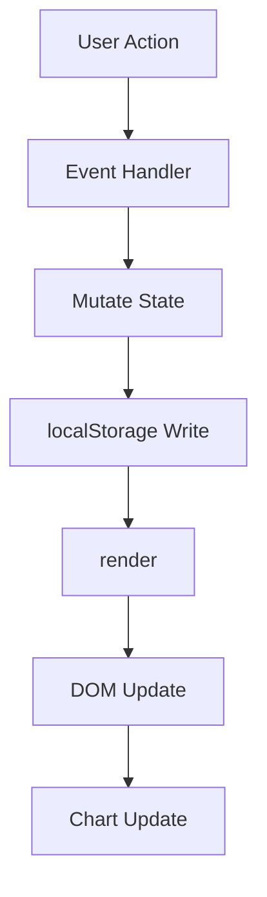
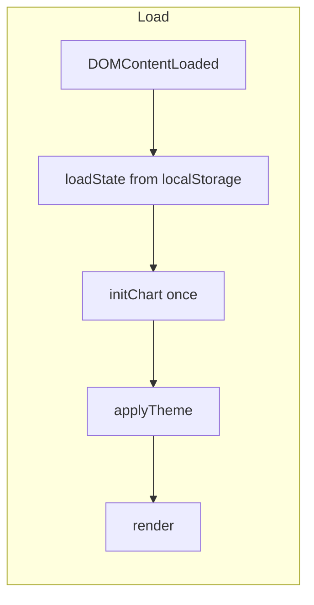

# Design Document

## Expense & Budget Visualizer (expense-budget-visualizer)

---

## Overview

A mobile-first, single-page web application for tracking daily personal spending. The app runs entirely in the browser with no backend, no build step, and no package installation. All persistent data lives in `localStorage`. The user records transactions (name, amount, category), reviews them in a scrollable sortable list, sees a live total balance, a Chart.js pie chart of spending by category, a monthly summary, a spending limit with progress bar, custom categories, and a dark/light theme toggle.

The entire implementation lives in exactly three files:

| File | Role |
|---|---|
| `index.html` | Semantic markup, Chart.js CDN script, loads `css/style.css` and `js/app.js` |
| `css/style.css` | All styling: CSS custom-property theming, layout, components, responsive rules |
| `js/app.js` | All logic: state, persistence, rendering, event handlers, chart, toast/undo, theme |

There is no bundler, no ES module syntax, no `import`/`export`, no `require`, and no server. The app is opened directly as a static page (local file or GitHub Pages) and works fully offline except for the Chart.js CDN dependency, which degrades gracefully.

---

## Architecture

### Overall Pattern

The application follows a one-way data-flow pattern:

1. A **user action** fires a DOM event.
2. The attached **event handler** mutates the single `state` object.
3. The handler writes the affected slice of state to **localStorage**.
4. The handler calls **`render()`** (or a specific render sub-function, e.g. theme changes update only chart colors).
5. `render()` and its sub-functions read `state` and update the DOM.





### State Object

A single module-level `state` object is the only source of truth. Every rendered view is derived from it; the DOM is never read back to reconstruct state.

```js
// DEFAULT_CATEGORIES is declared in Section 1: ['Food', 'Transport', 'Fun']

let state = {
  transactions: [],       // [{ id, name, amount, category, date }]
  categories: [...DEFAULT_CATEGORIES],
  limit: null,            // Number or null
  sort: 'newest',         // 'newest' | 'oldest' | 'amount-desc' | 'amount-asc' | 'category-asc'
  theme: 'light'          // 'light' | 'dark'
};
```

### Entry Point

All event listeners are attached inside one `DOMContentLoaded` handler. Chart initialization, theme application, state load, and the initial `render()` also happen there, in that order.

### localStorage Keys and Safe Defaults

| Key | Stored value | Safe default on missing/corrupt |
|---|---|---|
| `transactions` | JSON array of Transaction objects | `[]` |
| `categories` | JSON array of category name strings | `['Food', 'Transport', 'Fun']` |
| `limit` | JSON number or `null` | `null` |
| `sort` | One of the five sort ids | `'newest'` |
| `theme` | `'light'` or `'dark'` | `prefers-color-scheme` fallback, else `'light'` |

Every read and every write of every key is wrapped in its own `try/catch`. A corrupted value (e.g. `JSON.parse` throws, or parsed value has the wrong shape) falls back to the safe default. A failed write (private mode, quota) is silently ignored so the app keeps working in memory.

---

## Components and Interfaces

This section lists every component, its DOM contract (element ids), and its responsibilities. All ids listed here MUST exist in `index.html`, and `js/app.js` MUST reference only these ids.

### Element ID Inventory

| Element | Purpose |
|---|---|
| `#themeToggle` | Checkbox input inside the toggle switch label; `change` event toggles theme |
| `#totalBalance` | Total spending figure, formatted IDR |
| `#transactionForm` | Form wrapping item name, amount, category |
| `#itemName` | Text input, transaction name |
| `#itemAmount` | Number input, whole rupiah amount (`type="number" step="1" min="1" max="999999999"`) |
| `#itemCategory` | Select populated from `state.categories` |
| `#formErrors` | `aria-live="polite"` region receiving inline form error messages |
| `#transactionList` | Scrollable list container for transaction rows |
| `#sortSelect` | Sort dropdown (5 options) |
| `#expenseChart` | `<canvas>` for the Chart.js pie chart |
| `#chartContainer` | Fixed-height wrapper around the canvas; `position: relative` |
| `#chartNoData` | Absolutely-positioned "No data yet" overlay |
| `#chartFallback` | Friendly message shown when Chart.js CDN failed to load |
| `#categoryInput` | Text input for new category name |
| `#addCategoryBtn` | Button submitting a new category |
| `#categoryList` | Rendered category chips with delete buttons for eligible custom categories |
| `#categoryErrors` | `aria-live="polite"` region for category validation errors |
| `#limitInput` | Number input for spending limit (`type="number" step="1" min="1" max="999999999"`) |
| `#limitProgress` | Progress bar wrapper (hidden when no valid limit) |
| `#limitProgressFill` | Inner fill div of the progress bar |
| `#limitWarning` | `aria-live='polite'` region always present in the DOM; text content set to the warning when over limit, cleared otherwise; never hidden |
| `#monthlySummary` | Section containing the month selector and summary figures |
| `#monthSelect` | Month selector built from distinct transaction year-months |
| `#summaryBody` | Summary figures (total, count, per-category, top category) |
| `#toast` | Fixed-position toast container |
| `#toastMessage` | Text span inside the toast |
| `#toastUndo` | Undo button inside the toast, visible only during the 5-second undo window |

### Component Responsibilities

**Transaction Form.** Validates on submit: Item Name must be non-empty after trimming; Amount must be a positive whole number ≥ 1 (checked with `Number.isInteger`). Invalid fields get an inline error message inside `#formErrors` and the transaction is not added. On success the transaction is created with `id: Date.now()`, `date: new Date().toISOString()`, added to `state.transactions`, persisted, all fields cleared, `render()` called, and a toast shown.

**Transaction List.** Every transaction renders as a row with: name, amount (IDR formatted), category, date, delete button. Each delete button's `aria-label` is set with `setAttribute('aria-label', 'Delete ' + tx.name)` so screen readers announce which item will be deleted. The list container has a fixed `max-height` and `overflow-y: auto`. Empty state shows a message. Delete removes the transaction, saves, renders, and shows a toast with Undo for 5 seconds. All user-supplied text is inserted via `textContent` only; `innerHTML` is never used for user data.

**Total Balance.** Sum of all amounts, formatted with `Intl.NumberFormat('id-ID', { style: 'currency', currency: 'IDR', maximumFractionDigits: 0 })`, labeled "Total Balance". When a limit exists and the total exceeds it, the element gets the `.over-limit` class (red).

**Pie Chart.** One Chart instance created once at startup (guarded by a `typeof Chart === 'undefined'` check). Updates mutate `chart.data` and call `chart.update()`. Empty state keeps the canvas in the DOM at fixed container height and shows the `#chartNoData` overlay; it never hides the canvas with `display: none`. Theme changes update chart text and legend colors. Category colors are derived via `getCategoryColor(name)` (default categories Food, Transport, Fun get fixed palette slots 0, 1, 2 respectively; custom categories hash over indexes 3 and above).

**Category Manager.** Defaults Food, Transport, Fun are permanent (no delete button ever). A custom category shows a delete button only while it has zero associated transactions. New category names are trimmed and duplicate-checked case-insensitively against existing names. Valid additions persist, appear in `#itemCategory`, get a palette color via `getCategoryColor(name)` for the chart.

**Monthly Summary.** `#monthSelect` options come from the distinct `YYYY-MM` values derived from `getMonthKey(tx)` (local year/month), sorted most recent first. Selecting a month displays: total spent, transaction count, per-category breakdown, top-spending category. After rebuilding the options, `#monthSelect.value = selectedMonth` is set to restore the visible selection. Defaults to the most recent month on load and when the last transaction of the latest month is deleted. Empty state message when no transactions exist.

**Sort Control.** Five options: `newest`, `oldest`, `amount-desc`, `amount-asc`, `category-asc` (Category A–Z). Changing it updates `state.sort`, persists, and re-renders the list. `restoreControls()` restores `#sortSelect.value` to `state.sort` on startup.

**Spending Limit.** A number input. A valid limit shows the progress bar: fill width = `min(total / limit * 100, 100)%`. Over limit: bar full and red, `.over-limit` on the total, warning message set as `#limitWarning.textContent` (the element is always present in the DOM, never hidden; only its text changes), and `.over-limit` class on individual rows whose `tx.amount > state.limit`. Clearing/invalidating the input removes the bar, red states, clears `#limitWarning.textContent`, and removes all transaction highlights. `restoreControls()` restores `#limitInput.value` to `state.limit` on startup.

**Theme Toggle.** A styled checkbox switch (`#themeToggle`). `change` toggles the `dark` class on `<body>`, persists `theme`, and updates chart colors. It does not trigger a full `render()`.

**Toast & Undo.** `#toast` slides in via a `.visible` class and auto-dismisses (3 s plain, 5 s with Undo). The Undo button restores the deleted transaction at its original index, saves, renders, and dismisses the toast.

---

## Data Models

### Transaction

```js
{
  id: Number,          // Date.now() at creation, unique per session
  name: String,       // trimmed user input
  amount: Number,     // positive integer (rupiah)
  category: String,   // one of state.categories
  date: String        // ISO 8601 timestamp of creation, new Date().toISOString()
}
```

### State

```js
{
  transactions: Transaction[],
  categories: String[],          // ['Food','Transport','Fun', ...custom]
  limit: Number | null,
  sort: 'newest' | 'oldest' | 'amount-desc' | 'amount-asc' | 'category-asc',
  theme: 'light' | 'dark'
}
```

### Derived Values (computed in render, never stored)

- **Total balance**: `state.transactions.reduce((sum, tx) => sum + tx.amount, 0)`
- **Per-category totals**: aggregate `state.transactions` by `category`
- **Distinct months**: set of `getMonthKey(tx)` values (uses local year/month via `getFullYear()`/`getMonth()+1`), sorted most recent first
- **Monthly figures**: filtered by selected `YYYY-MM`, then total, count, per-category, top category (ties broken by descending amount then alphabetical category name)

### localStorage Schema

Each key stores one JSON-serialized value as described in the Architecture section. Transactions are stored as a plain JSON array. `limit` stores `JSON.stringify(number)` or `'null'`. `sort` and `theme` store JSON-quoted strings.

---

## HTML Structure (`index.html`)

```html
<!DOCTYPE html>
<html lang="en">
<head>
  <meta charset="UTF-8" />
  <meta name="viewport" content="width=device-width, initial-scale=1.0" />
  <title>Expense &amp; Budget Visualizer</title>
  <link rel="stylesheet" href="css/style.css" />
</head>
<body>
  <div class="container">

    <!-- Header: title + theme toggle -->
    <header class="app-header">
      <h1>💸 Expense Tracker</h1>
      <label class="toggle-switch" for="themeToggle">
        <input type="checkbox" id="themeToggle" aria-label="Toggle dark mode" />
        <span class="toggle-track"><span class="toggle-knob"></span></span>
      </label>
    </header>

    <!-- Total balance -->
    <section class="card total-card" aria-label="Total balance">
      <h2>Total Balance</h2>
      <p id="totalBalance" class="total-balance">Rp0</p>
      <!-- over-limit warning region: always present in DOM, text cleared when not over limit -->
      <p id="limitWarning" class="limit-warning" aria-live="polite"></p>
      <!-- progress bar -->
      <div id="limitProgress" class="limit-progress" hidden>
        <div id="limitProgressFill" class="limit-progress-fill"></div>
      </div>
    </section>

    <!-- Transaction form -->
    <section class="card form-card" aria-label="Add transaction">
      <h2>Add Transaction</h2>
      <form id="transactionForm" novalidate>
        <div class="form-row">
          <label for="itemName">Item Name</label>
          <input type="text" id="itemName" autocomplete="off" />
        </div>
        <div class="form-row">
          <label for="itemAmount">Amount (Rp)</label>
          <input type="number" id="itemAmount" step="1" min="1" max="999999999" inputmode="numeric" />
        </div>
        <div class="form-row">
          <label for="itemCategory">Category</label>
          <select id="itemCategory"></select>
        </div>
        <div id="formErrors" class="form-errors" aria-live="polite"></div>
        <button type="submit" class="btn btn-primary">Add Transaction</button>
      </form>
    </section>

    <!-- Sort control + transaction list -->
    <section class="card list-card" aria-label="Transactions">
      <div class="list-header">
        <h2>Transactions</h2>
        <label for="sortSelect">Sort by</label>
        <select id="sortSelect">
          <option value="newest">Newest</option>
          <option value="oldest">Oldest</option>
          <option value="amount-desc">Amount High to Low</option>
          <option value="amount-asc">Amount Low to High</option>
          <option value="category-asc">Category A–Z</option>
        </select>
      </div>
      <ul id="transactionList" class="transaction-list"></ul>
    </section>

    <!-- Pie chart -->
    <section class="card chart-card" aria-label="Spending by category">
      <h2>Spending by Category</h2>
      <div id="chartContainer" class="chart-container">
        <canvas id="expenseChart" aria-label="Pie chart of spending by category" role="img"></canvas>
        <div id="chartNoData" class="chart-no-data" hidden>No data yet</div>
        <div id="chartFallback" class="chart-fallback" hidden>
          Chart could not be loaded. The app works fine without it.
        </div>
      </div>
    </section>

    <!-- Category manager -->
    <section class="card category-card" aria-label="Manage categories">
      <h2>Categories</h2>
      <div class="category-add">
        <label for="categoryInput">New category</label>
        <input type="text" id="categoryInput" autocomplete="off" />
        <button type="button" id="addCategoryBtn" class="btn btn-secondary">Add</button>
      </div>
      <div id="categoryErrors" class="form-errors" aria-live="polite"></div>
      <div id="categoryList" class="category-list"></div>
    </section>

    <!-- Spending limit -->
    <section class="card limit-card" aria-label="Spending limit">
      <h2>Spending Limit</h2>
      <label for="limitInput">Limit (Rp)</label>
      <input type="number" id="limitInput" step="1" min="1" max="999999999" inputmode="numeric" />
    </section>

    <!-- Monthly summary -->
    <section class="card monthly-card" aria-label="Monthly summary">
      <h2>Monthly Summary</h2>
      <label for="monthSelect">Month</label>
      <select id="monthSelect"></select>
      <div id="summaryBody" class="summary-body"></div>
    </section>

  </div>

  <!-- Toast -->
  <div id="toast" class="toast" role="status">
    <span id="toastMessage"></span>
    <button type="button" id="toastUndo" class="toast-undo" hidden>Undo</button>
  </div>

  <!-- Chart.js from CDN, before app.js, both deferred -->
  <script src="https://cdn.jsdelivr.net/npm/chart.js@4.4.1/dist/chart.umd.min.js" defer></script>
  <script src="js/app.js" defer></script>
</body>
</html>
```

Notes:

- Both scripts use `defer`; `defer` preserves document order, so Chart.js is defined before `app.js` runs. `DOMContentLoaded` fires after both have executed, which is why the chart guard works there.
- Every input has an associated `<label for="…">`. The theme toggle input carries `aria-label='Toggle dark mode'` directly on the `<input>`, not on the wrapping `<label>`.
- All paths are relative (`css/style.css`, `js/app.js`) so the page works from `file://` and from GitHub Pages sub-paths.
- `aria-live="polite"` regions: `#formErrors`, `#categoryErrors`, `#limitWarning`.
- `#limitWarning` has no `hidden` attribute in the initial HTML so the `aria-live` region is always present in the DOM from page load. Its text content is empty until an over-limit condition occurs.

---

## CSS Design (`css/style.css`)

### Custom Properties and Theming

All colors are CSS custom properties. Light values on `:root`, dark overrides on `body.dark`:

```css
:root {
  --bg: #f8f9fa;
  --surface: #ffffff;
  --text: #212529;
  --text-muted: #6c757d;
  --accent: #4361ee;
  --accent-contrast: #ffffff;
  --danger: #ef233c;
  --danger-soft: rgba(239, 35, 60, 0.12);
  --border: #dee2e6;
  --success: #2b9348;
  --shadow: 0 1px 3px rgba(0, 0, 0, 0.08);
}

body.dark {
  --bg: #121212;
  --surface: #1e1e1e;
  --text: #e0e0e0;
  --text-muted: #9e9e9e;
  --accent: #7b8cde;
  --accent-contrast: #121212;
  --danger: #ff6b6b;
  --danger-soft: rgba(255, 107, 107, 0.18);
  --border: #333333;
  --success: #57cc99;
  --shadow: 0 1px 3px rgba(0, 0, 0, 0.4);
}
```

Every rule that uses a color references a variable; no rule hardcodes a raw color outside these two blocks. Theme toggling therefore changes the whole scheme by one class flip.

### Base Layout (Mobile-First)

- `body { background: var(--bg); color: var(--text); transition: background-color 0.3s, color 0.3s; }`
- `.container { width: 100%; max-width: 800px; margin: 0 auto; padding: 16px; display: grid; gap: 16px; }`
- Cards: `.card { background: var(--surface); border: 1px solid var(--border); border-radius: 12px; padding: 16px; box-shadow: var(--shadow); transition: background-color 0.3s, border-color 0.3s; }`
- Base layout targets 360 px: single column, stacked sections, 16 px font base, touch-friendly hit areas (buttons and inputs at least 44 px tall).
- List header: `.list-header { display: flex; flex-direction: column; gap: 8px; }`

### Toggle Switch

```css
.toggle-switch { position: relative; display: inline-flex; }
.toggle-switch input { position: absolute; opacity: 0; width: 100%; height: 100%; cursor: pointer; }
.toggle-track {
  width: 48px; height: 26px; border-radius: 13px;
  background: var(--border); transition: background-color 0.3s; position: relative;
}
.toggle-knob {
  position: absolute; top: 3px; left: 3px;
  width: 20px; height: 20px; border-radius: 50%;
  background: var(--surface); transition: transform 0.3s ease;
}
.toggle-switch input:checked + .toggle-track { background: var(--accent); }
.toggle-switch input:checked + .toggle-track .toggle-knob { transform: translateX(22px); }
```

The knob visibly slides because only `transform` (and track background) transitions.

### Progress Bar

```css
.limit-progress {
  height: 10px; border-radius: 5px;
  background: var(--border); overflow: hidden; margin-top: 12px;
}
.limit-progress-fill {
  height: 100%; width: 0;
  background: var(--accent);
  border-radius: 5px;
  transition: width 0.3s ease, background-color 0.3s;
}
.limit-progress-fill.over { background: var(--danger); }
```

JS sets `#limitProgressFill.style.width = Math.min(100, (total / limit) * 100) + '%'` and toggles the `.over` class. The fill never exceeds 100%.

### Toast

```css
.toast {
  position: fixed; bottom: 20px; left: 50%;
  transform: translate(-50%, 120%);
  background: var(--text); color: var(--bg);
  padding: 12px 20px; border-radius: 10px;
  display: flex; align-items: center; gap: 12px;
  z-index: 1000;
  transition: transform 0.3s ease, opacity 0.3s;
  opacity: 0;
}
.toast.visible { transform: translate(-50%, 0); opacity: 1; }
.toast-undo {
  background: transparent; border: 1px solid currentColor;
  color: inherit; border-radius: 6px; padding: 4px 10px; cursor: pointer;
}
```

The toast sits above every other element (`z-index: 1000`) and slides up from below the viewport via the `transform` transition.

### Transaction List

```css
.transaction-list {
  list-style: none; margin: 0; padding: 0;
  max-height: 320px; overflow-y: auto;
}
.transaction-list li {
  display: flex; align-items: center; gap: 8px;
  padding: 10px 4px; border-bottom: 1px solid var(--border);
  transition: background-color 0.3s;
}
.transaction-list li.over-limit { background: var(--danger-soft); }
```

### Over-Limit Total

```css
.total-balance { font-size: 1.75rem; font-weight: 700; }
.total-balance.over-limit { color: var(--danger); }
```

### Chart Container

```css
[hidden] { display: none !important; }

.chart-container { position: relative; height: 280px; }
.chart-container canvas { width: 100%; height: 100%; }
.chart-no-data, .chart-fallback {
  position: absolute; inset: 0;
  display: flex; align-items: center; justify-content: center;
  background: var(--surface);
  color: var(--text-muted); font-weight: 500;
}
```

The `[hidden] { display: none !important; }` rule ensures that the `hidden` attribute always wins over the `display: flex` on `.chart-no-data` and `.chart-fallback`. The container keeps its fixed height whether or not data exists; the overlay covers the (still-present, never `display:none`) canvas when shown.

### Focus Styles

```css
:where(a, button, input, select, [tabindex]):focus-visible {
  outline: 2px solid var(--accent);
  outline-offset: 2px;
}

.toggle-switch input:focus-visible + .toggle-track {
  outline: 2px solid var(--accent);
  outline-offset: 2px;
}
```

Every interactive element gets a visible focus ring for keyboard navigation. The toggle switch input is visually hidden (opacity: 0), so the focus ring is applied to the visible `.toggle-track` element instead via the adjacent sibling selector.

### Responsive Breakpoints

```css
/* Base: mobile, single column, 360px target */

@media (min-width: 600px) {
  #transactionForm .form-row { display: grid; grid-template-columns: 1fr 1fr; gap: 12px; }
  .chart-container { height: 320px; }
  .list-header { flex-direction: row; justify-content: space-between; align-items: center; }
}

@media (min-width: 800px) {
  .container { grid-template-columns: 1fr 1fr; grid-auto-flow: dense; }
  .total-card, .list-card { grid-column: span 2; }
}
```

Container is capped at `max-width: 800px` and centered; wider screens get a two-column card grid while the total and list span full width.

---

## JavaScript Architecture (`js/app.js`)

Plain browser script. No modules, no imports. All code is top-level in one file, organized in labeled sections with brief comments.

### Section 1: Constants

```js
const STORAGE_KEYS = { transactions: 'transactions', categories: 'categories', limit: 'limit', sort: 'sort', theme: 'theme' };
const DEFAULT_CATEGORIES = ['Food', 'Transport', 'Fun'];
const SORT_OPTIONS = ['newest', 'oldest', 'amount-desc', 'amount-asc', 'category-asc'];
const CATEGORY_COLORS = ['#4361ee', '#ef233c', '#2b9348', '#f77f00', '#8338ec',
                          '#00b4d8', '#6c757d', '#ffb703', '#06d6a0', '#b5179e'];
```

Category colors are assigned via `getCategoryColor(name)`, a helper that gives default categories (Food, Transport, Fun) fixed palette slots (indexes 0, 1, 2 respectively), and hashes custom categories over indexes 3 and above. This ensures default categories always get their canonical colors, and custom categories get a stable color regardless of their position in `state.categories`:

```js
function getCategoryColor(name) {
  // Default categories get fixed palette slots
  const fixed = { food: 0, transport: 1, fun: 2 };
  const key = name.toLowerCase();
  if (Object.prototype.hasOwnProperty.call(fixed, key)) return CATEGORY_COLORS[fixed[key]];
  // Custom categories: hash over indexes 3+
  let hash = 0;
  for (let i = 0; i < name.length; i++) hash = (hash * 31 + name.charCodeAt(i)) >>> 0;
  return CATEGORY_COLORS[3 + (hash % (CATEGORY_COLORS.length - 3))];
}
```

Also a single shared formatter:

```js
const idr = new Intl.NumberFormat('id-ID', { style: 'currency', currency: 'IDR', maximumFractionDigits: 0 });
```

### Section 2: State

```js
let state = {
  transactions: [],
  categories: [...DEFAULT_CATEGORIES],
  limit: null,
  sort: 'newest',
  theme: 'light',
};
let chart = null;            // Chart.js instance, created once
let chartAvailable = false; // false when CDN failed
let undoData = null;        // { tx, index, timeoutId } during the 5s undo window
let toastTimeoutId = null;
let selectedMonth = null;   // 'YYYY-MM' currently shown in monthly summary
```

### Section 3: Storage Helpers

Each read is individually guarded; a corrupt or wrong-shaped value falls back to the default.

```js
function readJSON(key, fallback) {
  try {
    const raw = localStorage.getItem(key);
    if (raw === null) return fallback;
    return JSON.parse(raw);
  } catch (e) { return fallback; }
}

function writeJSON(key, value) {
  try { localStorage.setItem(key, JSON.stringify(value)); } catch (e) { /* quota/private mode: ignore */ }
}

function loadState() {
  // transactions: validate every field; drop records that fail
  let txs = readJSON(STORAGE_KEYS.transactions, []);
  if (!Array.isArray(txs)) txs = [];
  txs = txs.filter(t =>
    t &&
    Number.isFinite(t.id) &&
    typeof t.name === 'string' && t.name.trim() !== '' &&
    Number.isInteger(t.amount) && t.amount >= 1 &&
    typeof t.category === 'string' &&
    typeof t.date === 'string' && !isNaN(new Date(t.date).getTime())
  );
  state.transactions = txs;

  // categories: must be a non-empty array of strings; always contains defaults
  let cats = readJSON(STORAGE_KEYS.categories, null);
  if (!Array.isArray(cats) || !cats.every(c => typeof c === 'string')) cats = [...DEFAULT_CATEGORIES];
  DEFAULT_CATEGORIES.forEach(d => { if (!cats.some(c => c.toLowerCase() === d.toLowerCase())) cats.push(d); });
  state.categories = cats;

  // limit: positive integer or null
  let limit = readJSON(STORAGE_KEYS.limit, null);
  state.limit = (Number.isInteger(limit) && limit >= 1 && limit <= 999999999) ? limit : null;

  // sort: must be a known option
  const sort = readJSON(STORAGE_KEYS.sort, 'newest');
  state.sort = SORT_OPTIONS.includes(sort) ? sort : 'newest';

  // theme: 'light' | 'dark', resolved later against prefers-color-scheme if unset
  const theme = readJSON(STORAGE_KEYS.theme, null);
  state.theme = theme === 'dark' || theme === 'light' ? theme : null;

  // Re-add any category used by a surviving transaction that isn't already in state.categories
  txs.forEach(t => {
    if (!state.categories.some(c => c.toLowerCase() === t.category.toLowerCase())) {
      state.categories.push(t.category);
    }
  });
}

function saveTransactions() { writeJSON(STORAGE_KEYS.transactions, state.transactions); }
function saveCategories()   { writeJSON(STORAGE_KEYS.categories, state.categories); }
function saveLimit()        { writeJSON(STORAGE_KEYS.limit, state.limit); }
function saveSort()         { writeJSON(STORAGE_KEYS.sort, state.sort); }
function saveTheme()        { writeJSON(STORAGE_KEYS.theme, state.theme); }
```

### Section 4: Derived Data

```js
function getMonthKey(tx) {
  const d = new Date(tx.date);
  const y = d.getFullYear();
  const m = String(d.getMonth() + 1).padStart(2, '0');
  return `${y}-${m}`;
}

function getTotal() {
  return state.transactions.reduce((sum, tx) => sum + tx.amount, 0);
}

function getSortedTransactions() {
  const copy = [...state.transactions];
  switch (state.sort) {
    case 'oldest':      return copy.sort((a, b) => a.date.localeCompare(b.date));
    case 'amount-desc': return copy.sort((a, b) => b.amount - a.amount);
    case 'amount-asc':  return copy.sort((a, b) => a.amount - b.amount);
    case 'category-asc':return copy.sort((a, b) => a.category.localeCompare(b.category, 'en'));
    default:            return copy.sort((a, b) => b.date.localeCompare(a.date)); // newest
  }
}

function getDistinctMonths() {
  const months = [...new Set(state.transactions.map(getMonthKey))];
  return months.sort().reverse(); // most recent first
}

function getMonthTransactions(month) {
  return state.transactions.filter(t => getMonthKey(t) === month);
}
```

`getMonthKey(tx)` derives the local year and month from the transaction's ISO date string using `getFullYear()` and `getMonth() + 1`, ensuring month grouping matches the user's local time zone (UTC+7 or any other offset) rather than UTC.

### Section 5: Rendering

`render()` is the single redraw entry point. It always runs the six sub-renders in a fixed order so the layout settles consistently:

```js
function render() {
  renderTotal();
  renderList();
  renderChart();
  renderLimit();
  renderMonthlySummary();
  renderCategories();
}
```

**`renderTotal()`** — sums amounts via `getTotal()`, writes `idr.format(total)` into `#totalBalance.textContent`, and toggles the `.over-limit` class based on `state.limit !== null && total > state.limit`.

**`renderList()`** — takes `getSortedTransactions()`, clears `#transactionList`, and appends one `<li>` per transaction. Row content (name, `idr.format(amount)`, category, formatted date) and every attribute value is set via `textContent` and DOM properties, never `innerHTML`. Each delete button has `setAttribute('aria-label', 'Delete ' + tx.name)` so screen readers announce which item will be deleted. Each row gets a delete `<button>` with `data-id`. If `state.limit !== null && tx.amount > state.limit`, the row gets the `.over-limit` class. When the array is empty, a single empty-state `<li>` ("No transactions yet") is shown instead.

**`renderChart()`** — if `!chartAvailable`, returns (the fallback message is already displayed). When `state.transactions` is empty: `#chartNoData.hidden = false`, set `chart.data.labels = []`, `chart.data.datasets[0].data = []`, `chart.data.datasets[0].backgroundColor = []`, call `chart.update()`. Otherwise: `#chartNoData.hidden = true`, aggregate totals per category (only categories with a nonzero total), then set `labels` (category names), `datasets[0].data` (totals), `datasets[0].backgroundColor` (palette colors per category, using `getCategoryColor(name)` for each category name), and call `chart.update()`. Chart text and legend colors are read from the live CSS variables (see Theme section) and applied through the chart options before `update()`.

**`renderLimit()`** — if `state.limit` is null: `#limitProgress.hidden = true`, clear `#limitWarning.textContent` (the element stays in the DOM; never use `hidden` on it), `.over-limit` removed from `#totalBalance` (also handled in `renderTotal`), and row highlighting is left to `renderList` (which checks `state.limit`). Otherwise: show `#limitProgress`, compute `pct = Math.min(100, (getTotal() / state.limit) * 100)`, set `#limitProgressFill.style.width = pct + '%'`, and toggle the `.over` class on the fill. If total exceeds the limit, set `#limitWarning.textContent` to "You have exceeded your spending limit.", add `.over-limit` to `#totalBalance`; otherwise clear `#limitWarning.textContent`.

**`renderMonthlySummary()`** — rebuilds `#monthSelect` options from `getDistinctMonths()`. Month label is formatted using local date construction:

```js
const [year, mon] = month.split('-').map(Number);
const label = new Date(year, mon - 1, 1).toLocaleDateString('en-US', { month: 'long', year: 'numeric' });
```

After rebuilding the options, sets `#monthSelect.value = selectedMonth` to restore the visible selection. If `selectedMonth` is missing or no longer has transactions, default it to `getDistinctMonths()[0]`. If there are no months at all, `#summaryBody` shows an empty-state message and returns. For the selected month, `#summaryBody` displays: total (IDR), transaction count, a per-category breakdown (category name + IDR amount, sorted descending), and the top-spending category (highest total; ties broken by category name A–Z). All values via `textContent`.

**`renderCategories()`** — renders `#categoryList` as chips: each chip shows the name and a colored dot using `getCategoryColor(name)`. Default categories (case-insensitive match against `DEFAULT_CATEGORIES`) never get a delete button. A custom category gets a delete button only when no transaction references it (checked case-insensitively against `tx.category`); otherwise the button is omitted (hidden). It also repopulates `#itemCategory` options from `state.categories`, preserving the current selection when possible.

### Section 6: Chart Initialization

```js
function initChart() {
  const ctx = document.getElementById('expenseChart');
  if (!ctx) return;
  if (typeof Chart === 'undefined') {
    // CDN failed: show friendly message, keep app functional
    chartAvailable = false;
    const fallback = document.getElementById('chartFallback');
    const noData = document.getElementById('chartNoData');
    if (fallback) fallback.hidden = false;
    if (noData) noData.hidden = true;
    return;
  }
  chartAvailable = true;
  chart = new Chart(ctx, {
    type: 'pie',
    data: { labels: [], datasets: [{ data: [], backgroundColor: [] }] },
    options: {
      responsive: true,
      maintainAspectRatio: false,
      plugins: {
        legend: { position: 'bottom', labels: { color: getChartTextColor() } },
        tooltip: {
          callbacks: {
            label: (ctx) => ' ' + ctx.label + ': ' + idr.format(ctx.parsed)
          }
        }
      }
    }
  });
}
```

The instance is created exactly once. Every later update mutates `chart.data.*` and calls `chart.update()`; `chart.destroy()` is never called during normal operation.

### Section 7: Theme

```js
function getCSSColor(name) {
  return getComputedStyle(document.body).getPropertyValue(name).trim();
}
function getChartTextColor() {
  return getCSSColor('--text');
}

function applyTheme() {
  if (state.theme === null) {
    state.theme = window.matchMedia('(prefers-color-scheme: dark)').matches ? 'dark' : 'light';
  }
  document.body.classList.toggle('dark', state.theme === 'dark');
  document.getElementById('themeToggle').checked = state.theme === 'dark';
  updateChartColors();
}

function updateChartColors() {
  if (!chartAvailable || !chart) return;
  chart.options.plugins.legend.labels.color = getChartTextColor();
  chart.update();
}
```

`applyTheme()` runs once during startup, after `loadState()` and before the first `render()`.

### Section 8: Toast & Undo

```js
function showToast(message, withUndo = false) {
  const toast = document.getElementById('toast');
  document.getElementById('toastMessage').textContent = message;
  const undoBtn = document.getElementById('toastUndo');
  undoBtn.hidden = !withUndo;
  toast.classList.add('visible');
  clearTimeout(toastTimeoutId);
  // 3s plain, 5s when the undo option must stay reachable
  toastTimeoutId = setTimeout(() => toast.classList.remove('visible'), withUndo ? 5000 : 3000);
}

function dismissToast() {
  clearTimeout(toastTimeoutId);
  document.getElementById('toast').classList.remove('visible');
}

function clearUndo() {
  if (undoData) { clearTimeout(undoData.timeoutId); undoData = null; }
  document.getElementById('toastUndo').hidden = true;
}
```

Delete flow: remove transaction, remember `{ tx, index, timeoutId }` in `undoData` where `timeoutId = setTimeout(clearUndo, 5000)`, save, render, `showToast('Transaction deleted', true)`. Undo click: `state.transactions.splice(undoData.index, 0, undoData.tx)`, save, render, `clearUndo()`, `dismissToast()`.

### Section 9: Event Handlers (all inside DOMContentLoaded)

```js
function restoreControls() {
  document.getElementById('sortSelect').value = state.sort;
  document.getElementById('limitInput').value = state.limit !== null ? state.limit : '';
}

document.addEventListener('DOMContentLoaded', () => {
  loadState();
  applyTheme();
  initChart();
  restoreControls();  // sets #sortSelect.value = state.sort and #limitInput.value = state.limit ?? ''
  render();

  // --- Transaction form submit ---
  document.getElementById('transactionForm').addEventListener('submit', (e) => {
    e.preventDefault();
    const name = document.getElementById('itemName').value.trim();
    const amountInput = document.getElementById('itemAmount').value;
    const category = document.getElementById('itemCategory').value;
    const errors = document.getElementById('formErrors');
    errors.textContent = '';

    const messages = [];
    if (!name) messages.push('Item name is required.');
    const amount = Number(amountInput);
    if (!amountInput || !Number.isInteger(amount) || amount < 1 || amount > 999999999) messages.push('Amount must be a whole number between 1 and 999,999,999.');

    if (messages.length) {
      messages.forEach(m => { const p = document.createElement('p'); p.textContent = m; errors.appendChild(p); });
      return;
    }

    const tx = { id: Date.now(), name, amount, category, date: new Date().toISOString() };
    state.transactions.push(tx);
    saveTransactions();
    e.target.reset();
    clearUndo();
    render();
    showToast('Transaction added.');
  });

  // --- Delete (event delegation on the list) ---
  document.getElementById('transactionList').addEventListener('click', (e) => {
    const btn = e.target.closest('button.delete-btn');
    if (!btn) return;
    const id = Number(btn.dataset.id);
    const index = state.transactions.findIndex(t => t.id === id);
    if (index === -1) return;
    const [tx] = state.transactions.splice(index, 1);
    saveTransactions();
    clearUndo();
    undoData = { tx, index, timeoutId: setTimeout(clearUndo, 5000) };
    render();
    showToast('Transaction deleted.', true);
  });

  // --- Undo ---
  document.getElementById('toastUndo').addEventListener('click', () => {
    if (!undoData) return;
    state.transactions.splice(Math.min(undoData.index, state.transactions.length), 0, undoData.tx);
    saveTransactions();
    clearUndo();
    dismissToast();
    render();
    showToast('Delete undone.');
  });

  // --- Sort ---
  document.getElementById('sortSelect').addEventListener('change', (e) => {
    state.sort = e.target.value;
    saveSort();
    renderList();
  });

  // --- Limit ---
  document.getElementById('limitInput').addEventListener('input', (e) => {
    const v = Number(e.target.value);
    state.limit = Number.isInteger(v) && v >= 1 && v <= 999999999 ? v : null;
    saveLimit();
    render();
  });

  // --- Month select ---
  document.getElementById('monthSelect').addEventListener('change', (e) => {
    selectedMonth = e.target.value || null;
    renderMonthlySummary();
  });

  // --- Add category (button click) ---
  document.getElementById('addCategoryBtn').addEventListener('click', () => {
    const input = document.getElementById('categoryInput');
    const errors = document.getElementById('categoryErrors');
    const name = input.value.trim();
    errors.textContent = '';

    if (!name) {
      errors.textContent = 'Category name is required.';
      return;
    }
    if (state.categories.some(c => c.toLowerCase() === name.toLowerCase())) {
      errors.textContent = 'That category already exists.';
      return;
    }
    state.categories.push(name);
    saveCategories();
    input.value = '';
    renderCategories();
    renderChart();
  });

  // --- Add category (Enter key in input) ---
  document.getElementById('categoryInput').addEventListener('keydown', (e) => {
    if (e.key === 'Enter') {
      e.preventDefault();
      document.getElementById('addCategoryBtn').click();
    }
  });

  // --- Delete category (delegation on the chip list) ---
  document.getElementById('categoryList').addEventListener('click', (e) => {
    const btn = e.target.closest('button.category-delete');
    if (!btn) return;
    const name = btn.dataset.name;
    if (DEFAULT_CATEGORIES.some(d => d.toLowerCase() === name.toLowerCase())) return;
    if (state.transactions.some(t => t.category.toLowerCase() === name.toLowerCase())) return;
    state.categories = state.categories.filter(c => c !== name);
    saveCategories();
    renderCategories();
    renderChart();
  });

  // --- Theme toggle (no full render) ---
  document.getElementById('themeToggle').addEventListener('change', (e) => {
    state.theme = e.target.checked ? 'dark' : 'light';
    document.body.classList.toggle('dark', state.theme === 'dark');
    saveTheme();
    updateChartColors(); // chart colors only; everything else is CSS-driven
  });
});
```

### Startup Order (inside DOMContentLoaded)

1. `loadState()` — read and sanitize all five localStorage keys; re-add categories used by surviving transactions.
2. `applyTheme()` — resolve saved theme or `prefers-color-scheme`, set `dark` class and checkbox state.
3. `initChart()` — one-time Chart creation or CDN-failure fallback.
4. `restoreControls()` — sets `#sortSelect.value = state.sort` and `#limitInput.value = state.limit ?? ''` so the UI controls reflect persisted state before the first render.
5. `render()` — initial full paint, which populates the transaction list, category chips, month selector, chart, and totals.

### Requirements Traceability

| Requirement | Design coverage |
|---|---|
| R0 (scope/files) | Architecture, HTML/CSS/JS sections — exactly three files, no build, no extra files |
| R1 (input form) | HTML form section, Section 9 submit handler, `#formErrors` aria-live |
| R2 (list) | `renderList()`, delete/undo handlers, CSS list rules, `textContent` policy, `aria-label` on delete buttons |
| R3 (total) | `renderTotal()`, IDR formatter |
| R4 (pie chart) | `initChart()`, `renderChart()`, chart container/overlay CSS, CDN guard |
| R5 (persistence) | Section 3 storage helpers, five keys, per-key try/catch |
| R6 (categories) | `renderCategories()`, add/delete category handlers, `getCategoryColor(name)` palette |
| R7 (monthly) | `renderMonthlySummary()`, `getDistinctMonths()`, `getMonthKey()`, month selector |
| R8 (sort) | `getSortedTransactions()`, `#sortSelect` handler, `sort` persistence, restored by `restoreControls()` on startup |
| R9 (limit) | `renderLimit()`, `#limitInput` handler, progress bar CSS, `#limitWarning` aria-live always in DOM, `restoreControls()` restores `#limitInput` on startup |
| R10 (theme) | `applyTheme()`, toggle switch CSS, CSS custom properties, chart color update |
| R11 (code quality) | Single DOMContentLoaded, single render, ID inventory, plain JS, relative paths, comments |
| R12 (responsive) | Mobile-first CSS, 360 px base, breakpoints, focus styles |
| R13 (toast) | Section 8, toast CSS |
| R14 (compatibility) | Vanilla ES2017-level syntax only, no exotic APIs, graceful CDN degradation |

---

## Error Handling

| Failure | Handling |
|---|---|
| localStorage unavailable (private mode, quota exceeded) | Every read wrapped per-key with fallback to defaults; every write silently ignored; app continues from memory |
| Corrupted stored JSON or wrong shape | `readJSON` + per-field validation in `loadState`: transactions with missing id, blank name, non-integer amount, non-string category, or invalid date are silently dropped; categories used by surviving transactions are re-added if missing |
| Chart.js CDN blocked/offline | `typeof Chart === 'undefined'` guard sets `chartAvailable = false`, shows `#chartFallback` message, app fully functional without the chart |
| Empty/corrupt categories list | Defaults re-merged; `DEFAULT_CATEGORIES` always present |
| Invalid sort value | Reset to `'newest'` |
| Invalid limit value | Treated as null: progress bar hidden, `#limitWarning` text cleared, red highlights removed |
| Form validation failure | Inline messages in `#formErrors` (aria-live), no state change |
| Duplicate/empty category | Inline error in `#categoryErrors` (aria-live), no state change |
| Undo pressed after 5 s window | `undoData` is null; handler no-ops |
| Deleting a category with transactions | Guard in delete handler refuses; button is also hidden by `renderCategories()` |

---

## Design Decisions and Rationale

1. **Single `state` object + single `render()`** over granular per-widget state. With five persisted keys and six views derived from overlapping data, one source of truth prevents drift between the total, chart, summary, and limit views. The cost (full list re-render on each mutation) is negligible at personal-finance scale.
2. **Mutate-in-place chart updates** (`chart.data` + `chart.update()`) instead of destroy/recreate. Recreating leaks canvases and resets animations; Chart.js 4 supports clean data mutation.
3. **Event delegation for the transaction list and category list.** Rows are created and destroyed constantly; delegation on the container avoids per-row listener churn.
4. **CSS custom properties for theming** rather than duplicated stylesheets. One class flip on `<body>` retints the entire app, and chart colors can be read from the same variables via `getComputedStyle`, keeping JS and CSS in sync.
5. **`textContent`-only rendering.** User input (item names, category names) never passes through `innerHTML`, which structurally prevents XSS in a localStorage-backed app.
6. **Overlay instead of `display: none` for the empty chart.** Keeps the canvas and its fixed-height container in the layout, avoiding Chart.js resize glitches when data reappears. The `[hidden] { display: none !important; }` rule ensures `hidden` correctly overrides the `display: flex` on the overlay elements.
7. **Case-insensitive category comparisons.** Users typing "food" and "Food" expect one category; the chart aggregation and duplicate checks both use lowercase comparison.
8. **Theme change skips full `render()`.** Theme is pure CSS plus chart label colors; re-rendering the list would be wasted work and could cause visible flicker.
9. **Hash-based category colors (`getCategoryColor`).** Default categories (Food, Transport, Fun) are assigned fixed palette slots (indexes 0, 1, 2 respectively) so their colors never change regardless of list mutations. Custom categories hash their name over indexes 3 and above, ensuring each custom category's color is stable across add/delete operations and page reloads, preventing jarring color shifts when the category list changes.
10. **Local-time month grouping (`getMonthKey`).** Using `getFullYear()`/`getMonth()` instead of `slice(0,7)` on the ISO string ensures transactions group into months by the user's local time zone, not UTC, preventing transactions made near midnight from appearing in the wrong month.
11. **`#limitWarning` always in DOM.** Keeping the `aria-live` region in the DOM from initial load ensures assistive technologies have already registered it before any warning text is inserted. Dynamically adding/removing the element would cause screen readers to miss the announcement.
